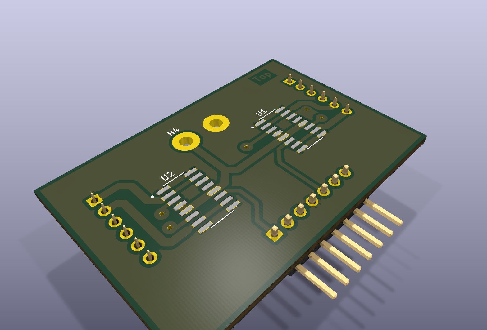
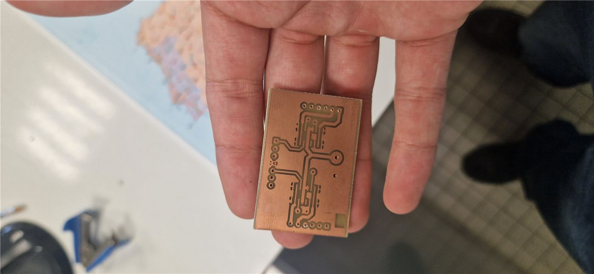
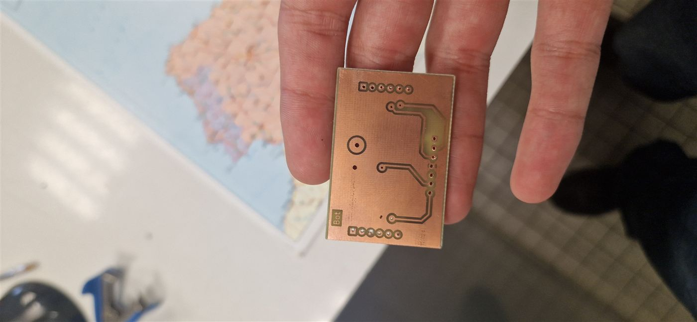
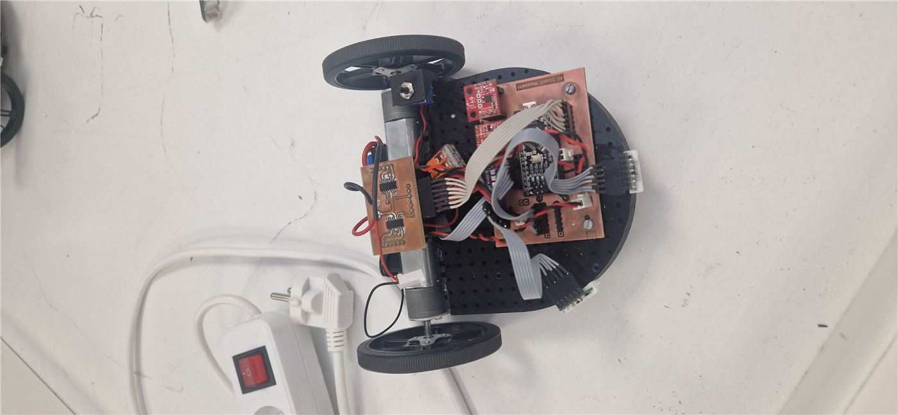

# Carte de commande de deux moteurs – robot (SAÉ BUT GEII)

Carte électronique conçue sous **KiCad** pour piloter les deux moteurs à courant continu d'un robot à deux roues : avancer, reculer et tourner.

Projet réalisé en **2e année de BUT GEII** (parcours Électronique et systèmes embarqués) à l'**IUT de Troyes**, dans le cadre d'une SAÉ. Nous étions un groupe de trois et chacun avait une carte à réaliser : **je me suis occupé de cette carte**, du schéma jusqu'à son intégration dans le robot.



## Ce que j'ai fait

- **Schéma électrique** sous KiCad (Eeschema)
- **Placement et routage** du circuit imprimé **2 couches** (Top / Bottom)
- **Soudure** des composants, dont les deux circuits en boîtier CMS SOIC-16
- **Intégration** de la carte sur le robot et **tests** avec la carte principale (Arduino Nano)

## Fonctionnement

| Élément | Rôle |
|---|---|
| **U1, U2 – VNH7070BAS** (STMicroelectronics) | Ponts en H intégrés à MOSFET, un par moteur (droite / gauche) |
| **J7** – connecteur 7 broches | Liaison avec l'Arduino : signaux `IN_A`, `IN_B` (sens de rotation) et `PWM` (vitesse) pour chaque moteur, + masse |
| **J2, J6** – connecteurs 6 broches | Sorties vers le moteur droit et le moteur gauche |
| **H3, H4** | Entrée d'alimentation **+12 V** / GND (servent aussi de trous de fixation) |

- Le **sens** de chaque moteur est choisi par les entrées `IN_A` / `IN_B` du pont en H.
- La **vitesse** est réglée par un signal **PWM** (MLI) envoyé par l'Arduino.

## Caractéristiques du circuit imprimé

- 2 couches de cuivre, dimensions **49,5 × 33 mm**
- Pistes de **0,6 mm** pour les signaux de commande et de **1,2 mm** pour la puissance (alimentation et sorties moteurs)
- **Plan de masse** (GND) sur toute la surface libre de la carte
- Composants CMS (SOIC-16) et traversants

## Photos

| Carte nue (dessus) | Carte nue (dessous) | Carte montée sur le robot |
|---|---|---|
|  |  |  |

## Contenu du dépôt

```
kicad/   fichiers source KiCad (projet, schéma, circuit imprimé)
docs/    schéma et circuit imprimé en PDF, rendus 3D, liste des composants
photos/  photos de la carte réalisée et du robot
```

- [Schéma électrique (PDF)](docs/schema.pdf)
- [Circuit imprimé – couches Top et Bottom (PDF)](docs/circuit_imprime.pdf)
- [Liste des composants (CSV)](docs/bom.csv)

Les fichiers s'ouvrent avec **KiCad 10**.

## Voir aussi

- [Multimètre numérique à Arduino Nano (SAÉ BUT 1)](https://github.com/lorenzo2S/multimetre-arduino-nano)

## Auteur

**Lorenzo Dos Santos** – étudiant en BUT GEII, parcours ESE, IUT de Troyes
